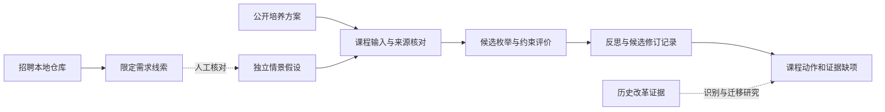

# 架构

## 实际数据流

公开培养方案与独立情景配置进入课程候选模块，生成保持原方案和有限课时调整，检查已建模约束并记录反思与修订。输出只说明课程动作和范围内可行性，缺少学生结果证据时就业效果为未识别。

招聘原始包由 archives/warehouse 在本机处理，需求工作台输出限定画像与回顾性误差。历史改革面板由 dataset/estimation 估计，planning 比较给定候选，reporting 负责可读报告。这些已有入口作为独立基线保留，后续按研究口径连接，不能把不同指标自动拼接。

## 模块

- curriculum.py 负责公开课程、情景边界、候选与约束，默认保留原方案。
- strategy.py 在候选上核对模块与构造路径，按失败触发修订重算，输出方向、招生和风险审阅。
- comparison.py 消费限量需求聚合与课程关系，输出文本覆盖界限、条件方向距离和规范化规模阈值。
- scenarios.py 计算原指标单位的文献参照与迁移情景，保留适用性及本校效果状态。
- submission.py 按显式公开白名单、要求状态和媒体元数据构建确定性ZIP，缺项只放行审阅版。
- archives.py 核对 ZIP 成员、RAR 目录和明确成员提取，完整性与内容事实分开。
- warehouse.py 使用 DuckDB 保存招聘字符串原值、版本、类型化视图与质量计数，可导出 Parquet。
- analysis/competition/workbench.py 负责需求侧固定词面、岗位族和回顾性比较，其结果解释范围见所属模块。
- dataset.py、estimation.py、planning.py、evidence.py 负责已有改革面板基线和背景文献隔离。
- pipeline.py 与 reporting.py 组织已有 JSON/HTML/Markdown 与哈希。cli.py 提供正常入口。

## 数据与产物

原始包留在本机，导入数据有版本与源哈希。LLM 接收字段、质量计数和有上限的聚合。各版本单独查询，同内容重复入库不增加行数，规则升级后可刷新类型化视图，既有 Parquet 是导出时快照。

单写者由调用方保证。完整内容先写临时位置，再原子发布；已有路径拒绝覆盖，失败清理本次临时产物。Windows 对已复现的瞬态发布锁有上限重试。输入和产物哈希对应实际处理内容，相同环境按约定核对确定性。

各入口具体字段与状态统一见 [数据契约](data-contract.md)，研究解释见 [项目说明](project.md)。
