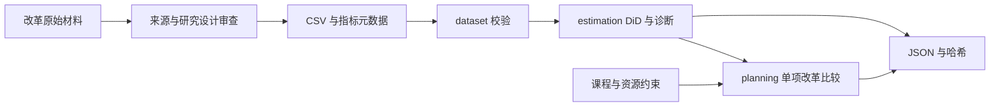

# 架构

dataset 校验格式和结构，estimation 在单位变化量上调用 statsmodels，planning 消费区间和资源配置，pipeline 核对行动与指标并提交完整产物，cli 提供参数与错误码。

输入通过路径传入，包与仓库示例独立。新增抽取或 GraphRAG 时先输出证据卡片，人工校验后进入估计。学生模型采用独立校准和结果契约。

运行先校验与计算，再写临时目录，完整后原子重命名。已有路径拒绝覆盖，旁路独占锁防止并发冲突。异常清理本次临时目录与锁，强制终止留下的锁需确认无运行实例后人工处理。
