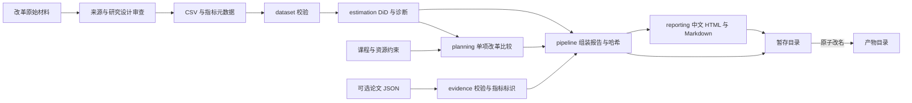

# 架构

这份文档说明数据从输入到产物的流向、各模块负责什么，以及产物怎么安全发布。

## 数据流

## 模块职责

| 模块 | 职责 |
| --- | --- |
| `dataset.py` | 校验外部输入：CSV 面板的结构与取值，JSON 元数据的字段与来源。 |
| `estimation.py` | 在单位变化量上拟合 OLS，给出 DiD 估计、HC3 区间、伪改革和逐单位删除诊断。 |
| `planning.py` | 消费估计区间和资源配置，检查学分、预算、容量约束，按保守增量排序。 |
| `pipeline.py` | 校验输入、跑估计和方案比较、生成报告与清单，原子发布产物目录。 |
| `evidence.py` | 校验可选论文卡片，标记目标指标对应关系，保留研究与数据获取范围。 |
| `reporting.py` | 将同一份内部结果渲染为中文 HTML 和 Markdown，转义外部文本。 |
| `cli.py` | 解析命令行参数、调用 `run`、返回退出码；错误信息直接说明哪里不合法。 |
| `__main__.py` | 支持 `python -m chanjiao_evidence` 入口。 |

输入通过路径传入，包与仓库示例相互独立。新增抽取或 GraphRAG 时，先输出证据卡片，人工校验后再进入估计。学生模型需要独立校准和结果契约，不能直接复用学校层估计。

## 产物发布

代码在 `pipeline.py`，发布遵循五条规则：

- 单写者：同一个目标输出目录同一时间只有一个写者，由调用方保证；代码不提供并发协调，不设锁。
- 暂存目录：先写同父目录下的临时目录，内容完整后再发布。
- 原子改名：临时目录完整后改名为目标目录，读者只会看到完整产物，不会读到半个报告。Windows 遇到瞬态文件锁时有上限重试，其他错误立即失败。
- 拒绝覆盖：目标路径已存在就直接报错，旧实验不会被悄悄替换。
- 失败清理：本次运行失败时删除自己的临时目录，不动已有产物。

这组规则解决真实问题：覆盖会毁掉旧实验，写到一半失败会留下不可信的半成品。并发锁解决的是不存在的场景，因此不实现；取舍记录见 [ADR 0002](decisions/0002-boundary-validation.md)。

JSON、HTML 和 Markdown 在内存中从同一份结果生成，然后共同发布。文献只作为报告背景，估计和方案排序继续由面板及方案输入确定。字段与产物哈希规则统一见 [数据契约](data-contract.md)。
